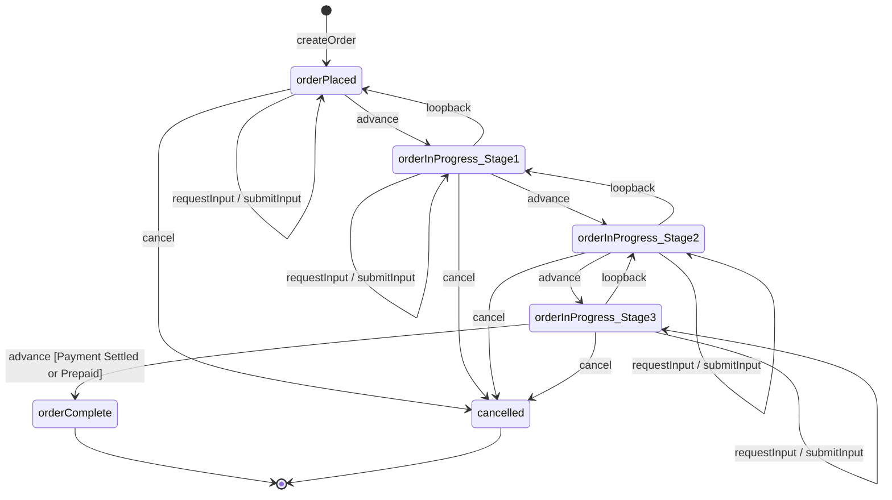

# Pizza Tracker — Technical Design Document (Phase 1)

| Field | Value |
| --- | --- |
| **Stack Target** | Next.js (App Router, TypeScript) on SST v3 (Ion) + OpenNext (AWS Lambda + CloudFront) with Amazon DynamoDB |
| **Cost Target** | 100% AWS Always Free Tier in production & 100% Offline Dev Container for local development |

---

## 1. System Architecture & Dual-Mode Topology

The application is architected around the Hexagonal (Ports and Adapters) pattern. Domain logic (FSM, RBAC, Configuration) is completely decoupled from cloud providers, allowing the entire application to run offline inside a VS Code / Cursor Dev Container with zero AWS connection.

```text
                               ┌────────────────────────────────────────────────────────┐
                               │                    Client Layer                        │
                               │  Customer Tracker UI  ·  Staff Ops UI  ·  Admin UI     │
                               │  (Next.js App Router SSR + Client Islands via SWR)     │
                               └───────────────────────────┬────────────────────────────┘
                                                           │
                        ┌──────────────────────────────────┴──────────────────────────────────┐
                        │                                                                     │
                        ▼ (Local Dev Container)                                               ▼ (AWS Production)
┌──────────────────────────────────────────────────┐               ┌──────────────────────────────────────────────────┐
│             Offline Docker Environment           │               │              SST v3 / OpenNext on AWS            │
│                                                  │               │                                                  │
│  ┌────────────────────────────────────────────┐  │               │  ┌────────────────────────────────────────────┐  │
│  │ Next.js App (:3000)                        │  │               │  │ CloudFront CDN (Always Free: 1TB/mo)       │  │
│  │  - Mock Auth / Role Switcher Header        │  │               │  └─────────────────────┬──────────────────────┘  │
│  │  - In-Process Event Bus (EventEmitter)     │  │               │                        ▼                         │
│  │  - Console/Terminal Notification Driver    │  │               │  ┌────────────────────────────────────────────┐  │
│  └─────────────────────┬──────────────────────┘  │               │  │ AWS Lambda (Always Free: 1M req/mo)        │  │
│                        │ DynamoDB Local API      │               │  │  - Cognito JWT Validator                   │  │
│                        ▼                         │               │  │  - EventBridge Client                      │  │
│  ┌────────────────────────────────────────────┐  │               │  └─────────────────────┬──────────────────────┘  │
│  │ amazon/dynamodb-local (:8000)              │  │               │                        ▼                         │
│  │  - In-memory/local SQLite storage engine   │  │               │  ┌────────────────────────────────────────────┐  │
│  │  - Auto-seeded with tenant, orders, roles  │  │               │  │ DynamoDB Table (Always Free: 25 RCU/WCU)   │  │
│  └────────────────────────────────────────────┘  │               │  └────────────────────────────────────────────┘  │
└──────────────────────────────────────────────────┘               └──────────────────────────────────────────────────┘
```

---

## 2. 100% Free-Tier & Zero-Cost Infrastructure Strategy

To guarantee that operating this application on AWS costs **$0.00/month**, all infrastructure adheres strictly to AWS Always Free services:

| Component | AWS Resource | Free Allowance | Free-Tier Configuration Rules |
| --- | --- | --- | --- |
| IaC & Deployment | SST v3 (Ion) + OpenNext | Open-source / Free | Deploys directly to your AWS account without third-party platform fees. |
| Compute / SSR | AWS Lambda | 1,000,000 requests/mo + 400,000 GB-s/mo | Memory set to 512MB–1024MB; timeout capped at 10s. |
| CDN & Routing | Amazon CloudFront | 1 TB data transfer/mo + 10M HTTP requests/mo | Caches static assets, public JS, and tenant CSS at the edge. |
| Database | Amazon DynamoDB | 25 GB storage + 25 RCU + 25 WCU | **CRITICAL:** Set billing mode to `PROVISIONED` (`read_capacity = 5`, `write_capacity = 5`), **NOT** `PAY_PER_REQUEST`. |
| Staff Auth | Amazon Cognito User Pools | 50,000 MAUs (Monthly Active Users) | Standard user pool without paid security add-ons. |
| Event Bus | Amazon EventBridge | 1,000,000 custom events/mo | Asynchronous domain event fan-out for notifications. |
| Assets Storage | Amazon S3 | 5 GB storage | For tenant logos and brand assets. (Minimal cost &lt;$0.01 even if outside free tier). |
| Email Notices | Amazon SES | Sandbox / 62,000 free from Lambda | Send transactional order updates to verified test addresses. |
| SMS Notices | Amazon SNS | **NO FREE TIER** | **STUBBED / DISABLED BY DEFAULT.** SMS is routed to terminal logging to avoid carrier fees. |

---

## 3. Local Development & Dev Container Architecture

The development container enables rapid local iteration without requiring internet access or AWS credentials.

### 3.1 Docker Compose Specification (`.devcontainer/docker-compose.yml`)

```yaml
version: "3.8"

services:
  app:
    image: mcr.microsoft.com/devcontainers/typescript-node:20
    volumes:
      - ..:/workspace:cached
    working_dir: /workspace
    command: sleep infinity
    environment:
      - NODE_ENV=development
      - DYNAMODB_ENDPOINT=http://dynamodb-local:8000
      - DYNAMODB_TABLE_NAME=PizzaTrackerDev
      - AWS_REGION=us-east-1
      - AWS_ACCESS_KEY_ID=local_dev_key
      - AWS_SECRET_ACCESS_KEY=local_dev_secret
      - AUTH_MODE=mock
      - NOTIFICATION_DRIVER=console
    ports:
      - "3000:3000"
    depends_on:
      - dynamodb-local

  dynamodb-local:
    image: amazon/dynamodb-local:latest
    container_name: pizza-tracker-dynamodb-local
    command: "-jar DynamoDBLocal.jar -sharedDb -inMemory"
    ports:
      - "8000:8000"
```

### 3.2 Dev Container Config (`.devcontainer/devcontainer.json`)

```json
{
  "name": "Pizza Tracker Local (Offline)",
  "dockerComposeFile": "docker-compose.yml",
  "service": "app",
  "workspaceFolder": "/workspace",
  "forwardPorts": [3000, 8000],
  "postCreateCommand": "npm install && npm run db:init && npm run db:seed",
  "customizations": {
    "vscode": {
      "extensions": [
        "dbaeumer.vscode-eslint",
        "esbenp.prettier-vscode",
        "bierner.markdown-mermaid"
      ]
    }
  }
}
```

### 3.3 Pluggable Adapters (Local vs. Cloud)

#### DynamoDB Client (`src/infra/dynamodb/client.ts`)

- If `process.env.DYNAMODB_ENDPOINT` is present, routes requests to `http://dynamodb-local:8000`.
- Otherwise, connects to AWS DynamoDB using the ambient Lambda IAM role.

#### Local Auth Switcher (`src/infra/auth/session.ts`)

In development (`AUTH_MODE=mock`), staff session is derived from an HTTP header or dev toolbar cookie:

- `x-mock-role: kitchen_staff | delivery_driver | store_manager`
- `x-mock-tenant: acme`

Bypasses Cognito login redirects during local UI component building.

#### Notification Driver (`src/infra/notifications/index.ts`)

In development, `ConsoleNotificationChannel` intercepts messages and writes formatted JSON to stdout instead of calling SES or SMS.

---

## 4. DynamoDB Single-Table Data Model

| Field | Value |
| --- | --- |
| **Table Name** | `PizzaTracker` (Prod) / `PizzaTrackerDev` (Local) |
| **Provisioning Mode** | `PROVISIONED` (Read: 5, Write: 5 — safely within the 25 unit limit) |

### 4.1 Key Conventions

| Entity Type | PK | SK | Description |
| --- | --- | --- | --- |
| Tenant Profile | `TENANT#<tenantId>` | `PROFILE` | Brand settings, locales, active config version. |
| Tenant Config | `TENANT#<tenantId>` | `CONFIG#<version>` | Immutable JSON workflow, i18n, and role schemas. |
| Order Snapshot | `TENANT#<tenantId>` | `ORDER#<orderId>` | Current FSM state, version, and actor metadata. |
| Order Event | `TENANT#<tenantId>` | `ORDER#<orderId>#EVT#<ulid>` | Immutable event ledger (ULID sortable by time). |
| Order Input | `TENANT#<tenantId>` | `ORDER#<orderId>#INPUT#<inputId>` | Interactive customer feedback challenges. |
| Staff Role | `TENANT#<tenantId>` | `ROLE#<roleId>` | Permissions list for the tenant role. |

### 4.2 Global Secondary Indexes (GSIs)

#### GSI1 (Status Queue)

| Attribute | Value |
| --- | --- |
| **PK** | `GSI1PK` → `TENANT#<id>#STATUS#<status>` |
| **SK** | `GSI1SK` → `STEP#<stepKey>#TS#<isoTimestamp>` |
| **Use Case** | Kitchen and Driver boards query active orders filtered by step. |

#### GSI2 (Public Token Deep-Link)

| Attribute | Value |
| --- | --- |
| **PK** | `GSI2PK` → `TOKEN#<publicToken>` |
| **SK** | `GSI2SK` → `ORDER` |
| **Use Case** | Anonymous customer views order status without exposing internal database keys. |

---

## 5. 5-Stage Event-Driven FSM Engine

### 5.1 Canonical Milestones

The tracker strictly maintains 5 user-facing milestones:

| Step Key | Description |
| --- | --- |
| `orderPlaced` | Initial order creation (payment pending or prepaid). |
| `orderInProgress_Stage1` | Kitchen Prep / Assembly. |
| `orderInProgress_Stage2` | Baking / Cooking / Quality Check. |
| `orderInProgress_Stage3` | Packaging / Out for Delivery / Ready for Pickup. |
| `orderComplete` | Order fulfilled and payment confirmed. |

### 5.2 State Transitions & Loopback Rules



### 5.3 Loopback & Restart Mechanics

- **`restart` (Stages 1–3):** Stays in the current step. Increments `restartCount[step]`, stamps a new `stepEnteredAt`, appends a `RESTART` event, and triggers notification.
- **`loopback` (Stages 1–3):** Steps backward to the immediate predecessor (Stage3 → Stage2, Stage2 → Stage1, Stage1 → `orderPlaced`).

#### Interactive Input Checkpoints

- When staff triggers `requestInput(schemaKey)`, order status changes to `awaiting_input`.
- Normal step advancement is locked until the customer completes `submitInput()`.
- The input result can automatically trigger `advance`, `restart`, or `loopback` based on tenant business rules.

---

## 6. Multi-Tenant Configuration & RBAC

Tenant configurations are loaded server-side and cached in memory per request.

```ts
export type StepKey =
  | "orderPlaced"
  | "orderInProgress_Stage1"
  | "orderInProgress_Stage2"
  | "orderInProgress_Stage3"
  | "orderComplete";

export interface TenantConfig {
  tenantId: string;
  version: number;
  branding: {
    displayName: string;
    primaryColor: string;
    logoUrl?: string;
  };
  defaultLocale: string;
  i18n: Record<string, Record<string, string>>; // locale -> { key: translation }
  stepPresentations: Record<StepKey, { titleKey: string; icon: string }>;
  rolePermissions: Record<string, string[]>;
  businessRules: {
    allowAdvanceWhileAwaitingInput: boolean;
    requirePaymentSettledToComplete: boolean;
  };
}
```

### Role Permissions Matrix

| Role | Permissions |
| --- | --- |
| **Customer** | `order:read_public`, `input:submit_customer` |
| **Kitchen Staff** | `order:read`, `step:advance:orderInProgress_Stage1`, `step:advance:orderInProgress_Stage2`, `step:restart:*`, `input:request` |
| **Delivery Driver** | `order:read`, `step:advance:orderInProgress_Stage3`, `step:advance:orderComplete`, `input:request` |
| **Store Manager** | Full permissions including `order:cancel` and tenant configuration updates |

---

## 7. Project File Structure

```text
├── .devcontainer/
│   ├── devcontainer.json               # Dev container configuration
│   └── docker-compose.yml              # Node.js app + amazon/dynamodb-local
├── scripts/
│   ├── init-db.ts                      # Provisions table & GSIs on DynamoDB Local
│   └── seed-data.ts                    # Seeds sample tenant 'acme', users, and orders
├── sst.config.ts                       # SST v3 (Ion) infrastructure definitions
├── src/
│   ├── app/
│   │   ├── layout.tsx
│   │   ├── page.tsx
│   │   ├── t/[tenant]/
│   │   │   ├── track/[orderId]/page.tsx # SSR Customer Tracker
│   │   │   └── (staff)/
│   │   │       ├── queue/page.tsx       # Kitchen & Dispatch Boards
│   │   │       └── admin/config/page.tsx
│   │   └── actions/
│   │       └── orders.ts               # Next.js Server Actions (FSM entrypoint)
│   ├── domain/
│   │   ├── fsm/                        # Pure FSM engine, guards, and transition logic
│   │   ├── rbac/                       # Role and permission verification
│   │   └── config/                     # Tenant configuration schema & i18n
│   ├── infra/
│   │   ├── dynamodb/                   # Client factory (Local vs. AWS) & Repositories
│   │   ├── auth/                       # Mock Auth (dev) vs. Cognito JWT (prod)
│   │   └── notifications/              # Console logger (dev) vs. EventBridge/SES (prod)
│   └── components/
│       ├── customer/OrderTracker.tsx   # Client component with SWR short-polling
│       ├── staff/QueueBoard.tsx
│       └── dev/DevRoleSwitcher.tsx     # Floating toolbar for role testing in local dev
```

---

## 8. Implementation Roadmap

### Phase 2: Local Environment & Scaffolding

- Initialize Next.js project with TypeScript, Tailwind CSS, and SST v3.
- Set up `.devcontainer/` and `docker-compose.yml`.
- Implement `scripts/init-db.ts` and `scripts/seed-data.ts` to spin up `PizzaTrackerDev` in DynamoDB Local.

### Phase 3: Pure FSM Domain & Local Adapters

- Implement pure FSM transition and guard functions in `src/domain/fsm/`.
- Implement DynamoDB repository with optimistic locking (`ConditionExpression: version = :v`).
- Add `DevRoleSwitcher` and `ConsoleNotificationChannel` for local verification.
- Write comprehensive Vitest unit tests covering all forward, loopback, and restart state transitions.

### Phase 4: UI & Server Actions

- Build SSR Tracker page with SWR polling island (3s customer, 1s staff).
- Build Kitchen Queue Board with step advancement and restart controls.
- Build customer interactive input modal (e.g., ingredient substitution flow).

### Phase 5: SST v3 AWS Deployment

- Configure `sst.config.ts` for OpenNext on AWS Lambda and CloudFront.
- Define DynamoDB table with `PROVISIONED` billing (5 RCU / 5 WCU) to lock in Free Tier status.
- Attach least-privilege IAM policies and verify $0.00 cloud deployment.
